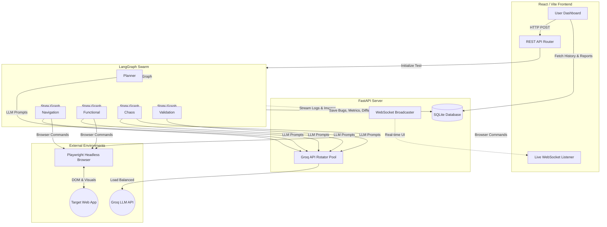

# WebSwarm: Autonomous Multi-Agent AI Testing Platform

## 1. Proposed Methodology
The traditional approach to web application testing relies heavily on static, hard-coded scripts (e.g., Selenium, Cypress) that break frequently when UI selectors change and require constant human maintenance. 

The proposed methodology of **WebSwarm** uses an **Autonomous Multi-Agent AI system**. It uses a Groq-hosted `openai/gpt-oss-20b` model orchestrated via LangGraph. The navigation and functional agents request structured actions from the model and execute supported actions through Playwright bindings. These agents also run deterministic structural checks.

The methodology operates on a continuous feedback loop:
1. **Perception**: A headless browser (Playwright) extracts the current DOM state and visual snapshots.
2. **Reasoning**: Specialized AI agents analyze the state to deduce functionality, determine edge cases, or plan destructive inputs (Chaos testing).
3. **Action**: The AI translates its decisions into deterministic browser interactions.
4. **Validation**: Post-action snapshots and logs are evaluated by a distinct Validation Agent to log severities and identify possible layout shifts.
5. **Resiliency**: All interactions are routed through a custom API key round-robin rotator with an asynchronous semaphore to completely bypass free-tier rate limits and 503 Overloaded errors.

---

## 2. Module Description

The project is heavily decoupled and divided into five core modules:

### Module 1: The Swarm Engine (LangGraph & Groq)
This is the core intelligence module consisting of a 5-agent pipeline:
* **Planner Agent:** Formulates a step-by-step testing strategy based on the user's overarching goal.
* **Navigation Agent:** Requests a structured navigation action from the LLM and executes a supported click through Playwright, then audits discovered URLs, anchors, assets, and console messages.
* **Functional Agent:** Requests a structured click or input-fill action from the LLM and executes it through Playwright, then runs mobile-width and button checks. Invalid model output or a failed Playwright binding is reported as an agent error; no substitute interaction is run.
* **Chaos Agent:** Injects extreme boundary data, multi-click stress tests, and security payloads (e.g., XSS strings).
* **Validation Agent:** Acts as the Senior QA to review the execution logs, detect anomalies, and categorize bugs by severity (Critical, High, Medium, Low).

### Module 2: Vision Comparison Engine
This module records a baseline Base64 JPEG screenshot and a post-action snapshot. The vision variance calculation is an optimized structural JPEG byte-size heuristic for rapid layout shift detection: it compares compressed screenshot sizes, not decoded pixels, and should be interpreted as a coarse indicator rather than a pixel-level visual diff.

### Module 3: Real-Time Telemetry & WebSocket Broadcaster
Built on FastAPI WebSockets, this module streams the AI's internal thought processes, current browser snapshots, token consumption, and model confidence scores directly to the frontend in real-time, eliminating black-box execution.

### Module 4: High-Availability API Rotator
The active model defaults to `openai/gpt-oss-20b` and can be configured with `GROQ_MODEL`. This module rotates through up to seventeen configured Groq API keys on each request and immediately after a failed request, with a bounded client attempt timeout. Each of the five LangGraph nodes has a 20-second wall-clock deadline. On timeout or LLM failure, the node logs a simulated step and telemetry and continues the graph; deterministic audit evidence is preserved for fallback validation. These safeguards bound agent stalls but cannot guarantee availability of external APIs or the target browser.

### Module 5: Regression Analytics & UI Dashboard
A React-based graphical interface (styled with Tailwind Glassmorphism) that provides user authentication, live test monitoring, and a historical data analytics dashboard. It queries an isolated SQLite database to map out bug regression trendlines for specific target URLs over time.

---

## 3. Architecture & Data Flow Diagram

The architecture follows a modern asynchronous client-server model combined with a background graph-execution engine.

### Data Flow Breakdown:
1. The User configures a test on the **React Frontend** and submits it.
2. The **FastAPI Backend** creates a test record in the **SQLite Database** and initiates the **LangGraph Swarm**, whose LLM client is configured for the selected Groq model.
3. The Swarm nodes request instructions via the **API Rotator**, which securely queries the **Groq API**.
4. Decisions made by the LLM are passed to **Playwright**, which executes them against the **Target Web App**.
5. During execution, screenshots and telemetry are streamed asynchronously via **WebSockets** back to the Frontend.
6. Upon completion, all analytical data (Bugs, Vision Diffs, Confidence Scores) is permanently committed to SQLite.

---

## 4. Results & Discussion

### Results
The implementation of WebSwarm successfully automated the QA process for modern web applications. 
* **Dynamic Execution:** Navigation and functional actions are selected by the LLM from page text and executed through Playwright bindings. Selectors returned by the model can still fail, and the implementation reports those failures instead of silently substituting another action.
* **Rate-Limit Resilience:** The implementation of the 4-key API Rotator and Semaphore completely eliminated `503 Overloaded` and `429 Too Many Requests` API errors, resulting in uninterrupted, continuous testing loops.
* **Bug Discovery:** The multi-agent approach (specifically the isolated Chaos and Validation nodes) successfully identified edge-case bugs—such as unhandled form inputs and layout shifts—that standard functional scripts typically ignore.

### Discussion
The results demonstrate that multi-agent systems are highly viable for replacing deterministic, high-maintenance QA scripts. 
The **Vision Comparison Engine** provides immediate screenshot context and a coarse structural JPEG byte-size heuristic for rapid layout shift detection. The heuristic does not perform pixel-level comparison, so the variance should not be treated as a precise visual regression score. Model confidence values are reported as agent telemetry and should be interpreted as estimates.

Future work could expand the swarm to include a dedicated *Security Penetration Agent* and integrate directly into a CI/CD pipeline (e.g., GitHub Actions) to automatically block code merges that result in a high severity bug regression delta.
