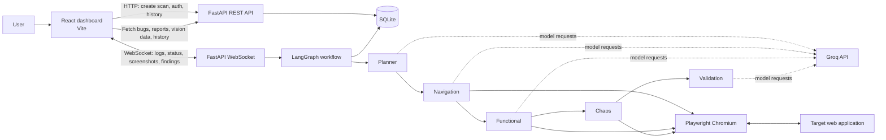

# WebSwarm Workflow, Architecture, and Tech Stack

## Project overview

WebSwarm is a web application testing platform. A user submits a target URL and testing goal through the React dashboard. The backend launches a headless browser and runs a five-agent LangGraph workflow. Progress, screenshots, and findings are streamed to the dashboard, while test records and reports are stored in SQLite.

## Workflow

1. **Configure a scan** — The user enters a target URL and optional testing goal on the dashboard.
2. **Create a test run** — The frontend sends the request to FastAPI at `POST /api/v1/start-swarm`. The backend records a pending run in SQLite and returns its test ID.
3. **Connect for live updates** — The live scan page opens a WebSocket at `/api/v1/ws/live-testing/{test_id}` and sends the start message with the target URL and goal.
4. **Launch the browser** — The backend starts Playwright Chromium, creates a page, and begins streaming screenshots.
5. **Run the agent graph** — LangGraph executes the agents in sequence:
   - **Planner** proposes a strategy based on the goal.
   - **Navigation** loads the page, follows a selected navigation action, and checks links, assets, and browser console messages.
   - **Functional** performs a selected interaction and checks UI behavior, including buttons and a 375px mobile layout.
   - **Chaos** probes visible inputs and buttons with boundary values and security payloads.
   - **Validation** reviews agent logs and findings, then assigns severities.
6. **Stream progress** — The backend sends agent status, log messages, telemetry, findings, and screenshots to the frontend over the WebSocket.
7. **Save and report** — The backend stores findings, metrics, and report data in SQLite, generates a downloadable HTML report, marks the run complete, and sends a final status event.

Each agent has a bounded execution time. Groq requests use the configured model and API key pool; when requests fail or time out, the workflow can use its fallback behavior and continue with deterministic checks where available.

## Architecture

The frontend is the user-facing control and results layer. FastAPI provides REST endpoints and the live WebSocket connection. LangGraph coordinates the agent sequence. Playwright interacts with the target site, while Groq provides model-assisted planning and analysis. SQLite holds local application and scan data.

## Tech stack

| Area | Technologies | Purpose |
|---|---|---|
| Frontend | React 19, Vite 8, Tailwind CSS 4 | Dashboard and live scan interface |
| Routing and UI | React Router, Lucide React | Page navigation and icons |
| Charts | Recharts | Historical scan analytics |
| Backend | Python, FastAPI, Uvicorn | REST API and application server |
| Live updates | FastAPI WebSockets, `websockets` | Streaming scan progress to the browser |
| Agent orchestration | LangGraph, LangChain Core | State graph and agent workflow |
| Language model | Groq via `langchain-groq`; default model `openai/gpt-oss-20b` | Planning, interaction choices, and validation analysis |
| Browser automation | Playwright with Chromium | Navigating and testing target web applications |
| Persistence | SQLite | Users, test runs, bugs, reports, and vision records |
| Configuration | `python-dotenv` | Loads local backend settings from `backend/.env` |

## Local development

- Frontend: `http://localhost:5173`
- Backend API and OpenAPI docs: `http://localhost:8000` and `http://localhost:8000/docs`
- Start scripts: `start.bat` on Windows or `start.sh` on macOS/Linux
- Keep real Groq credentials in `backend/.env`; use placeholders in `.env.example` and do not commit secrets.
